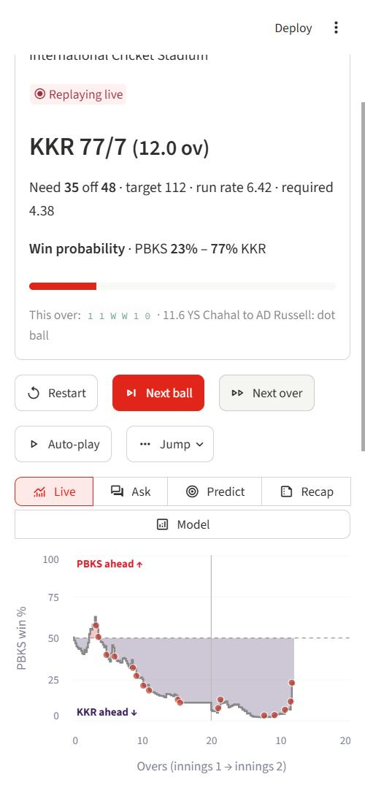
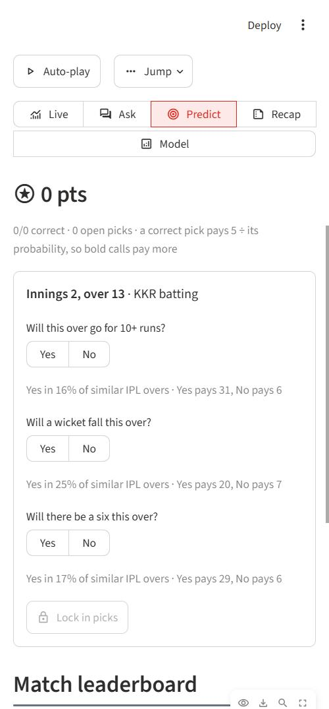
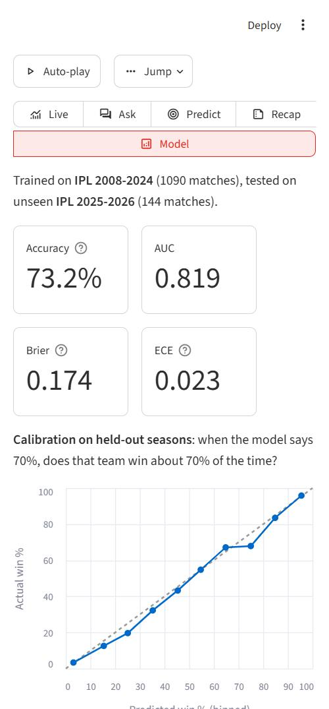

# MatchMate: an AI second screen for live cricket

**Live demo: [matchmatee.streamlit.app](https://matchmatee.streamlit.app)**. Best on a phone.
It opens on a 2025 thriller: tap *Next over*, or *Auto-play*, and watch the odds swing.
<!-- Demo video: add the 2-minute video link here once recorded (see docs/DEMO_SCRIPT.md). -->

> A casual fan has the IPL on TV and their phone in hand. MatchMate tells them, ball by ball,
> who's winning, why a moment mattered, and what to watch for next. It also lets them play
> along for free.

<p align="center">
  
  
  
</p>

## The problem

Casual fans often lose the thread of a T20 match. They can't tell:
- **Who is actually winning:** the scoreboard says 77/7, but is that good?
- **Why a wicket matters.** Some wickets decide a match and some barely move it.
- **What to watch for next over.**

Since the 2025 Online Gaming Act, Dream11 has dropped paid contests and repositioned itself as a
**second-screen sports platform**: watch-alongs, live commentary, fan reactions and
free-to-play contests. The goal is to keep fans engaged *during* the match, not just
before it. MatchMate is a prototype of that experience.

## User journey

1. **Pick a match.** Open the app on your phone and tap *Change match*. *Thrillers* lists the
   closest finishes from the latest seasons, without spoilers.
2. **Watch it unfold.** Step ball by ball or over by over, or press *Auto-play*. A compact
   scoreboard shows the score, what's needed and **live win probability**.
3. **Get told when it matters.** When one ball swings the game, a plain-language alert pops up:
   *"AD Russell's six lifted KKR's chances from 46% to 67%."*
4. **Ask the match.** *"Should I worry about this run rate?"* or *"How does Bumrah do at the death?"*
   An AI agent answers from real data through tool calls, never from guesses, and the answer
   shows which data it used.
5. **Play along between overs.** *"Will this over go for 10+?"* Each question shows how often it
   happened in similar IPL overs, and bolder correct calls pay more points. You compete on a
   match leaderboard.
6. **Get the recap.** At full time, a 5-line AI summary covers the result, the standout
   performances and the turning point, measured as the biggest swing in win probability.

## What's inside

| Feature | How it works |
|---|---|
| **Live win probability** | Logistic regression (vs XGBoost) on match state, one model per innings, trained on IPL 2008–2024 and evaluated on unseen 2025–26 |
| **Swing alerts** | Any ball that moves the odds by 10+ pts in a chase (6+ pts in the first innings), or any over that moves them by 15+ pts, gets explained in plain English |
| **Ask the match** | Gemini with function calling: 8 tools (`get_score`, `get_win_prob`, `player_stats`, `head_to_head`, `recent_balls`, `scorecard`, `venue_info`, `what_if`) |
| **Over predictions** | Free-to-play: 3 yes/no questions per over, with odds-based points from historical base rates (5 ÷ probability), and simulated fans for a match leaderboard |
| **Match recap** | Key facts (result, top performers, biggest swings) are **computed first**; Gemini only writes the prose |
| **Offline fallback** | With no API key, or if Gemini fails, Ask and Recap fall back to templates fed by the same tools, so the demo never breaks |

### Replaying past matches as if live

Live cricket APIs are paid. MatchMate replays any finished match from
[Cricsheet's](https://cricsheet.org) free ball-by-ball data **as if it were live**. The replay is
a pointer into a precomputed timeline. The UI, the agent's tools and the game all read only the
balls up to that pointer, so nothing can reveal what happens next (there's a test for this).
Swapping in a real feed later means replacing one data source, not the product.

### No spoilers, no leakage
- Player and venue stats only use matches **before** the replayed match's date.
- The venue **par score** is computed from earlier matches only, with a recent-league
  average plus a shrunk venue adjustment. That lets the model track scoring eras without
  seeing the future.
- Every 2025 and 2026 match in the app is **out-of-sample** for the model.

## Model results

Evaluated on **144 unseen matches (IPL 2025–26)**, scored on every ball:

| | Log loss ↓ | Brier ↓ | Accuracy | AUC |
|---|---|---|---|---|
| **Overall (selected models)** | **0.512** | **0.174** | **73.2%** | **0.819** |
| Chase: logistic regression ✓ | 0.380 | 0.122 | 82.4% | 0.910 |
| Chase: XGBoost | 0.486 | 0.152 | 77.8% | 0.884 |
| 1st innings: logistic regression ✓ | 0.634 | 0.222 | 64.6% | 0.699 |
| 1st innings: XGBoost | 0.677 | 0.235 | 62.6% | 0.693 |
| Baseline (base rate) | 0.69 | 0.25 | 55–57% | 0.5 |

- **Calibration:** expected calibration error is **0.023**. When the model says 70%, that team
  wins about 70% of the time (see the *Model* tab).
- **By phase:** chase accuracy rises from 76% in the powerplay to 84% in the middle overs and
  90% at the death.

**Why logistic regression beat XGBoost:** scoring jumped in the impact-player era. The average
first-innings par rose from about 167 in 2022 to about 190 in 2025–26. Trees can't extrapolate
beyond the totals they were trained on, so their probabilities were badly calibrated on
2025–26. A linear model on **era-relative** features (projected score vs par, runs needed per
wicket, required minus current rate) carries over to the new era. I kept both models in the
pipeline and chose per innings by held-out log loss. XGBoost uses monotone constraints so it
can't learn "losing a wicket helps".

## Architecture

```
Cricsheet JSON ──► data.py ──► deliveries / matches (parquet)
                                   │
                    features.py ◄──┤  par score (leak-free), match-state features
                                   │
                  train_model.py ──► win_prob.joblib + metrics.json + timelines.parquet
                                   │
      replay.py (pointer into timeline: snapshot, swings, scorecard; no lookahead)
          │             │                │                 │
      app.py (UI)   agent.py         game.py           recap.py
                   (Gemini + 8 tools) (predictions)    (facts → Gemini prose)
```

```
matchmate/
├── app.py                  # Streamlit app (mobile-first)
├── matchmate/
│   ├── config.py           # paths, team codes/colours, name normalisation
│   ├── data.py             # Cricsheet JSON → tidy tables
│   ├── features.py         # par score + features (shared by training and inference)
│   ├── winprob.py          # model inference + rules for decided chases
│   ├── replay.py           # match-replay engine, swing alerts, scorecards
│   ├── stats.py            # player / venue / head-to-head stats, fuzzy name matching
│   ├── agent.py            # Gemini agent + tools + offline fallback
│   ├── game.py             # over predictions, scoring, leaderboard
│   └── recap.py            # 5-line recap
├── scripts/                # download_data, build_dataset, train_model
├── data/processed/         # small committed parquet files (~6 MB)
├── models/                 # trained model + metrics
└── tests/                  # integrity, no-lookahead, model sanity, game scoring
```

## Run it locally

```bash
python -m venv .venv
.venv\Scripts\activate            # Windows  (macOS/Linux: source .venv/bin/activate)
pip install -r requirements-train.txt
streamlit run app.py
```

The processed data and trained model are committed, so the app runs right away. To rebuild
everything from scratch:

```bash
python scripts/download_data.py    # ~5 MB zip from cricsheet.org
python scripts/build_dataset.py    # parse 1,243 matches
python scripts/train_model.py      # train, evaluate, precompute timelines
pytest -q
```

To enable the AI agent, copy `.streamlit/secrets.toml.example` to `.streamlit/secrets.toml`
and add your Gemini key. You can set the `GEMINI_API_KEY` environment variable instead.

## Built with AI copilots

I built this with **Claude Code** as a pair programmer: scaffolding, the Streamlit UI, the
agent tools, tests and debugging. The model diagnosis (why XGBoost lost) came out of
experiments it ran on held-out seasons. I made the product decisions (problem framing, the
spoiler-free replay, odds-based points) and reviewed the model evaluation.

## Limitations and next steps
- Replays historical matches. A live feed (for example, a commercial cricket API) would plug
  into `replay.py`.
- The hall-of-fame leaderboard is a JSON file, so it resets when Streamlit Cloud restarts. A
  real launch would use a database (Supabase or Firestore).
- First-innings win probability is inherently uncertain (AUC 0.70). Adding team strength,
  for example from player ratings, is the obvious next feature.
- Bots on the match leaderboard are simulated, and labelled as bots in the app.

*Data: [Cricsheet](https://cricsheet.org), Open Data Commons Attribution License.*
